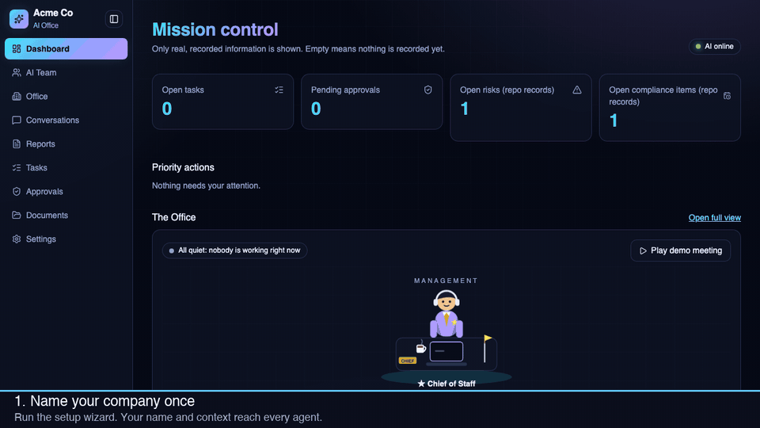
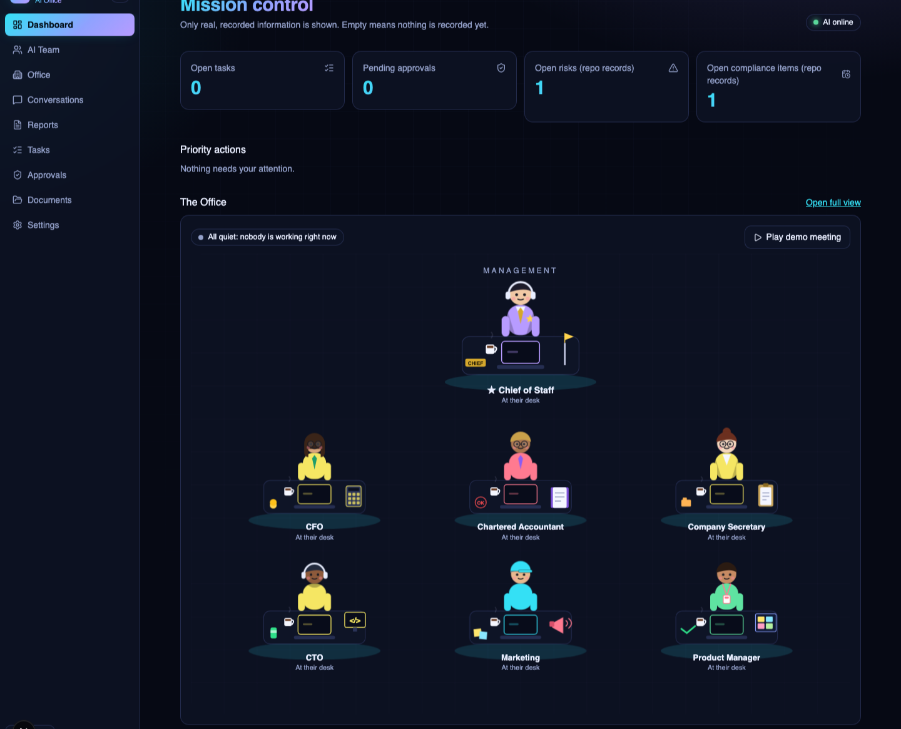

# AI Management Office

[](https://github.com/arunmenon1807/ai-management-office/actions/workflows/validate.yml)

An advisory, **read-only-by-default** multi-agent management office for a small company, built on [Claude Code](https://claude.com/claude-code) native features. Your main Claude session acts as **Chief of Staff** and delegates to six specialists (Company Secretary, Chartered Accountant, CFO, CTO, Product Manager, Marketing & Growth) using seven standard workflows (`/daily-brief`, `/weekly-review`, `/monthly-business-review`, `/compliance-check`, `/financial-review`, `/technology-review`, `/decision-review`).

You name your company and describe it once; every agent then works from that context. A guard hook keeps the AI from sending, filing, paying, deploying, pushing or deleting: it drafts and recommends, **you** decide and act. An optional local web app (Next.js) gives a dashboard, chat, tasks, approvals and reports.





*The local web app, set up for the fictional "Acme Co". Your company's name appears in the sidebar and page title.*

> **Not professional advice.** The specialists give decision support, not legal, tax, audit or financial advice. Statutory matters are confirmed by your appointed professionals. Regulatory content defaults to **India** (GST, ROC/MCA, TDS); see [docs/localising.md](docs/localising.md) for other jurisdictions.

## Run the UI and see it

You need [Node.js](https://nodejs.org) 24 or newer and Python 3. For AI chat you also need the [Claude Code CLI](https://claude.com/claude-code) signed in (`claude auth login`).

```bash
python3 scripts/init_company.py        # 1. name your company (about 2 minutes)
cd apps/web && npm install             # 2. one-time install
npm run dev                            # 3. then open http://localhost:3000
```

On macOS you can instead double-click `apps/launcher/start.command` (it builds on first run, then opens the browser). The server only listens on your own machine.

**How easy is it to use?** Setup is those three commands. After that there is nothing to configure to look around: the dashboard, AI Team, Office, Tasks, Approvals and Documents pages work immediately and show only real, recorded information (empty means nothing is recorded yet). To get answers, click **AI Team → Start conversation** on any specialist, or **Reports → Generate** to run a workflow such as the daily brief. Chat and reports use your Claude Code sign-in; see [docs/ai-auth-and-cost.md](docs/ai-auth-and-cost.md) for how usage is billed. A full tour is in [docs/app-guide.md](docs/app-guide.md).

## Optional: connect your tools (Google Drive, Gmail and more)

Everything above works with **no connectors**. Connect tools only when you want agents to read your real documents, mail or infrastructure. The agents never send, pay, deploy or delete: connectors are **read-only**, with two narrow exceptions you control (Gmail drafts, and new Drive files that you approve one click at a time).

**Connect Google Drive or Gmail**
1. Open [claude.ai/settings/connectors](https://claude.ai/settings/connectors), choose Google Drive (and/or Gmail) and sign in with your own Google account.
2. In the web app open **Settings → Connectors**. The connector should appear with a health status. Use **Authenticate** if it asks you to sign in again.
3. Note the folder IDs you want agents to use in `records/sources.md` (locators only, never contents). Sensitive files stay in Drive and are referenced by ID.

**Connect more connectors or plugins** (Vercel, Railway, GitHub, Cloudflare, Sentry, anything with an MCP server)
1. **Add it.** For a hosted connector use claude.ai/settings/connectors, or add an `https` MCP server in **Settings → Connectors → Add**. For stdio or API-key servers, or for Claude Code plugins, use `/mcp` and `/plugin` inside Claude Code or `claude mcp add` in a terminal. Authenticate with the provider's own sign-in, never by pasting keys into chat or files.
2. **Let the agents use it, read tools only.** Add the connector's read tool names (for example `mcp__vercel__list_projects`) to the `tools:` line of the agents that need it in `.claude/agents/`. The web app pre-approves exactly the read tools listed there.
3. **Check the guard.** For an unknown connector the guard allows tool names that start with a read verb (`get`, `list`, `search`, `read`, `describe`, `fetch`, `query`, `status`) and denies everything else, plus anything that exposes secrets (token, env, variables, API key). Review the connector's tools yourself, because a read-named tool with side effects would pass (see `docs/permission-model.md`).
4. **Record it.** Add a row to `docs/integration-inventory.md`, then run `python3 tests/validate.py` and add an allow case and a deny case for the new tools.

Details: [docs/integration-inventory.md](docs/integration-inventory.md), [docs/app-guide.md](docs/app-guide.md) (Connectors and Google Drive sections).

## Quick start (Claude Code only, no web UI)

```bash
git clone <your-copy-of-this-repo> my-office && cd my-office
python3 scripts/init_company.py        # asks for company name, country, currency, products, context
python3 tests/validate.py              # must show 0 failures
```

Then open the folder in Claude Code and read [docs/setup.md](docs/setup.md). The wizard writes `company/profile.json` and renders `CLAUDE.md` and `company/facts/` from `templates/`. Non-interactive use:

```bash
python3 scripts/init_company.py --name "Acme Co" --country India --currency INR --product "AcmeApp: a notes app" --yes
```

**Privacy:** once configured, this repo describes your company. Keep it in a **private** repository. Never commit secrets or identifiers; sensitive records go in `company/private/` (git-ignored).

## What is where

| Path | What |
|---|---|
| `CLAUDE.md` | Chief of Staff instructions + your company context (generated from `templates/CLAUDE.md.tmpl`) |
| `company/profile.json` | Your answers from the wizard |
| `company/facts/` | Founder-confirmed facts (authoritative layer) |
| `.claude/agents/`, `.claude/skills/` | The six specialists and seven workflows |
| `.claude/hooks/guard.py`, `.claude/guard-policy.json` | The approval guard |
| `records/` | Decisions, actions, risks, compliance, reports (`scripts/records.py`) |
| `apps/web/` | Optional local web app. macOS launcher in `apps/launcher/` |
| `docs/` | Setup, operating guide, architecture, permission model |
| `examples/` | A clearly-fictional (MOCK) decision workflow |

Verified vs not verified: [docs/limitations-and-next-steps.md](docs/limitations-and-next-steps.md). Contributing: [CONTRIBUTING.md](CONTRIBUTING.md). Questions and ideas: [Discussions](docs/community.md). Changes: [CHANGELOG.md](CHANGELOG.md). License: MIT.
